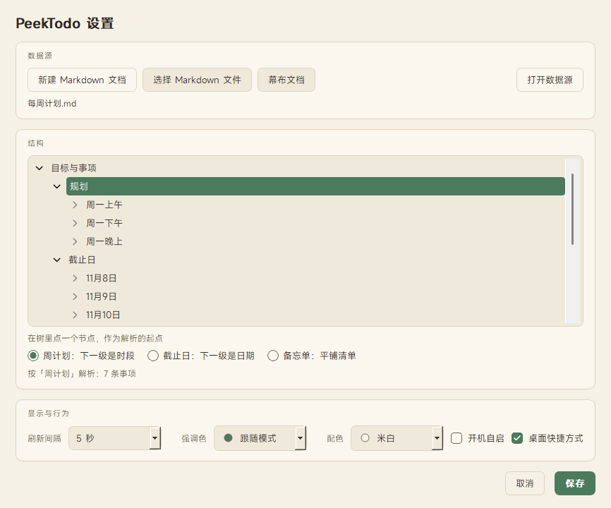
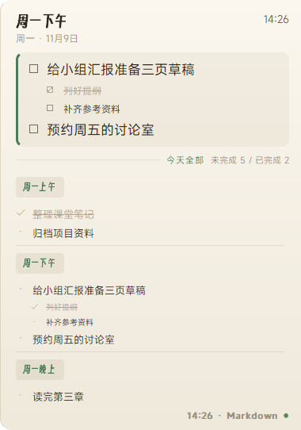
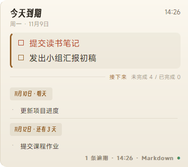
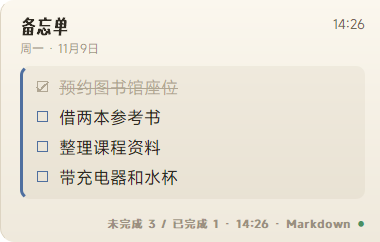

# PeekTodo

[中文说明](README.md)

A Windows to-do panel for weekly plans, deadlines, and memos. Move the pointer to the far right of your primary screen to reveal it. Move away to retract it. PeekTodo reads local Markdown files or backups from the Mubu desktop app.

## Install and run

### First-time setup

You need **Windows 10 or 11**, **Python 3.10 or later**, and **Git**. Run these four lines in PowerShell.

```powershell
git clone https://github.com/ConstVain/PeekTodo.git
cd PeekTodo
python -m pip install -e .
.\start.cmd
```

In Settings, choose a source and mode, leave **Desktop shortcut** checked, and click **Save**. This creates the **PeekTodo** icon on your desktop.

### Everyday use

**Double-click the PeekTodo desktop icon**. The app appears in the system tray. Move your pointer to the right edge of your primary screen to open the panel. To launch automatically when you sign in to Windows, enable **Start at login** in Settings.

## Set up a source

- **Existing Markdown**. Choose a file, select the root in the structure tree, choose a mode, and save.
- **New Markdown**. The template picker defaults to `Example-plan_simple.md`. After confirming the template, the save dialog suggests a filename such as `261108_目标与事项.md`. PeekTodo opens the new document for editing and selects it as the source. The built-in plan templates also select the plan root and weekly mode. Saving edits refreshes the structure tree automatically. Creating and choosing Markdown files share the last-used folder.
- **Mubu**. Open the document in the Mubu desktop app so it has a local backup, then select it from the Mubu document list in PeekTodo.

<p align="center">
  
</p>

Reopen Settings from the tray. Choose Cream or Dark, and let the accent follow the current mode, choose a preset, or pick a custom color and add it to the list. Use the trash icon to remove a color. **Refresh now** in the tray menu rereads the current source.

## Use the panel

| Action | Result |
| --- | --- |
| Move to the far right edge of the primary display | Reveal the panel |
| Move away | Retract the panel |
| Click the panel | Pin it |
| Click away from the panel or press Esc | Unpin it |
| Drag the top-left or bottom-left corner | Resize the panel and scale its text |
| Click the marker next to an item | Toggle its checkmark |

### Three modes

<table>
<tr>
<th width="33%">Weekly plan</th>
<th width="33%">Deadline</th>
<th width="33%">Memo</th>
</tr>
<tr>
<td></td>
<td></td>
<td></td>
</tr>
<tr>
<td>Group items by time slot, such as <code>周一下午</code> (Monday afternoon). The current slot appears above the rest of today's plan.</td>
<td>Group items by date, such as <code>11月9日</code> (November 9) or <code>明天</code> (tomorrow). Overdue and today's items appear above upcoming deadlines.</td>
<td>List items directly under the root. The panel shows the whole list.</td>
</tr>
</table>

Add weekday and time-slot aliases under `vocabulary` in `config.json`. Unrecognised groups still appear in the panel and are excluded from time filtering.

## Data and troubleshooting

- Panel checkmarks leave the source document intact. They live in `%APPDATA%\PeekTodo\.state.json` and expire after seven days.
- A source checkout prefers its own `config.json`. Without one, it can reuse `%APPDATA%\PeekTodo\config.json`. The installed copy uses the configuration in the user directory.
- PeekTodo makes no network requests. For Mubu, the panel's timestamp comes from the local backup. Recent edits appear after that backup updates. If a read fails, the panel shows a warning and keeps the last successful data from the current session.

<details>
<summary>Update PeekTodo or diagnose a data source</summary>

Quit PeekTodo from the tray, run `git pull` in the original checkout, and double-click the desktop icon again. If dependencies change, rerun `python -m pip install -e .` in the checkout. If you switch to a different checkout, launch from the new folder and save Settings once to point the desktop shortcut to that copy.

From the checkout, run the following commands to check which copy launches or see what PeekTodo recognises in the bundled sample. Substitute your own configuration path to diagnose your source.

```powershell
python -m peek_todo --where
python -m peek_todo --doctor --config config.example.json
```

</details>

## Development

```powershell
python -m pip install -e ".[dev]"
python -m pytest -q
```

The [architecture and code reading guide (Chinese)](docs/architecture.md) follows a refresh and a checkmark through the code.

## License

[GPL-3.0](LICENSE). See the [third-party notices](THIRD_PARTY_NOTICES.md) for the bundled fonts.
