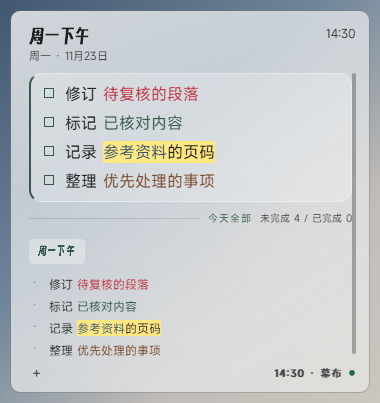
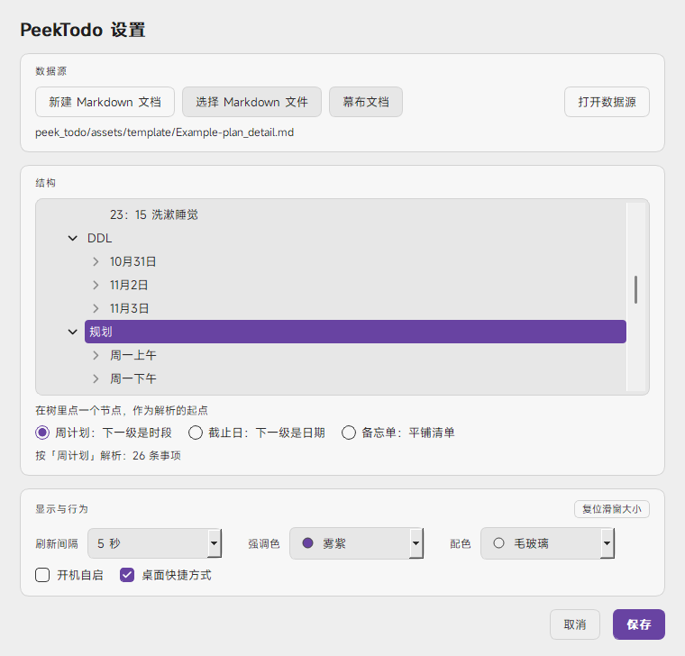
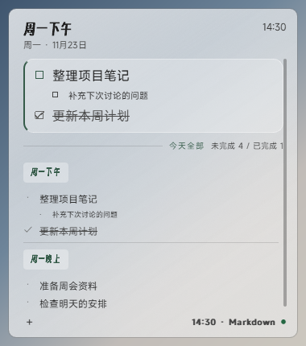
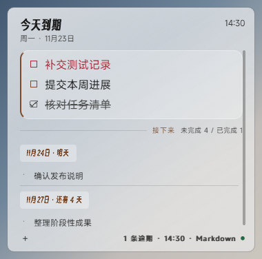
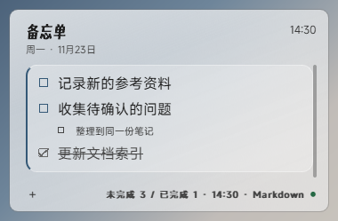

# PeekTodo

[中文说明](README.md)

A Windows to-do panel for weekly plans, deadlines, and memos. Move the pointer to the far right of your primary screen to reveal it. Move away to retract it. PeekTodo reads local Markdown files or backups from the Mubu desktop app.

## Install and run

### First-time setup

You need **Windows 10 or 11**, **Python 3.10 or later**, and **Git**. Run these four lines in PowerShell.

```powershell
git clone https://github.com/ConstVain/PeekTodo.git
cd PeekTodo
python -m pip install -e .
.\start.cmd
```

In Settings, choose a source and mode, leave **Desktop shortcut** checked, and click **Save**. This creates the **PeekTodo** icon on your desktop.

### Everyday use

**Double-click the PeekTodo desktop icon**. The app appears in the system tray. Move your pointer to the right edge of your primary screen to open the panel. To launch automatically when you sign in to Windows, enable **Start at login** in Settings.

## Update PeekTodo

### Update in place

1. Right-click the PeekTodo icon in the system tray and choose **Quit**.
2. Open PowerShell in the **original PeekTodo checkout**. You can find it under **Start in** in the desktop shortcut’s **Properties**. Use the Python environment you originally installed with and run these commands in order.

   ```powershell
   git pull --ff-only
   python -m pip install -e .
   ```

3. After both commands succeed, double-click your existing **PeekTodo** desktop icon or run `.\start.cmd` from that checkout. The app continues to use your configuration, checkmarks, and launch entries for that folder.

### Switch to a different folder or replace an older copy

If you originally downloaded a ZIP, use the `git clone` command in First-time setup to prepare a checkout, then follow these steps.

1. Quit the old copy. Run `.\start.cmd --where` in the old folder and back up the configuration and checkmark files it lists. Copy the configuration to the new checkout if it lives in the old program folder. Files in `%APPDATA%\PeekTodo` can stay there for the new copy to use.
   Older versions may also have a checkmark file in the old folder. Back it up and keep the original desktop shortcut in place until the new copy launches, so it can find the file and import compatible checkmarks.
2. In the new checkout, run `python -m pip install -e .` with the Python environment you intend to keep using, then run `.\start.cmd --setup`. Verify the source and root node. If your Markdown source used a relative path, select the original document again in Settings.
3. Enable **Desktop shortcut**, set **Start at login** to your preference, and click **Save**. This points the standard desktop shortcut and, if enabled, the login startup entry to the new folder.
4. Quit the current instance before relaunching from the desktop icon. In the shortcut’s **Properties**, check that **Start in** points to the new folder. After verifying that your data opens, remove any desktop shortcuts, taskbar pins, and Startup folder entries you created for the old copy, then archive the old program folder. If your source document lives inside the old folder, back it up and verify its new location in Settings first.

If PeekTodo says it is already running, quit the existing instance from the tray, then launch from the checkout you want to use.

## Set up a source

- **Existing Markdown**. Choose a file, select the root in the structure tree, choose a mode, and save.
- **New Markdown**. The template picker defaults to `Example-plan_simple.md`. After confirming the template, the save dialog suggests a filename such as `261108_目标与事项.md`. PeekTodo opens the new document for editing and selects it as the source. The built-in plan templates also select the plan root and weekly mode. Saving edits refreshes the structure tree automatically. Creating and choosing Markdown files share the last-used folder.
- **Mubu**. Open the document in the Mubu desktop app so it has a local backup, then select it from the Mubu document list in PeekTodo. The panel shows text colors and highlighter backgrounds in tasks and group headings, including when both appear on the same text.

<p align="center">
  
</p>

<p align="center">
  
</p>

Reopen Settings from the tray. Frosted Glass is the default theme. It uses live backdrop blur and system corner rounding on supported Windows 11 systems, with a translucent light gray rounded panel elsewhere. Cream, Dark, and VS Code Light are also available. Let the accent follow the current mode, choose a preset, or pick a custom color and add it to the list. Use the trash icon to remove a color. **Refresh now** in the tray menu rereads the current source.

With mode-based accents, Frosted Glass uses pine green for Weekly Plan, copper orange for Deadline, and slate blue for Memo. Mubu text in green, orange, and blue uses the corresponding shades and keeps its highlight background.

If connecting or switching an external monitor leaves the panel incorrectly sized, click **Reset panel size** in the upper-right corner of **Display and Behavior** in Settings. The panel immediately restores its default width and automatic height and returns to the right edge of the current primary display.

## Use the panel

| Action | Result |
| --- | --- |
| Move to the far right edge of the primary display | Reveal the panel |
| Move away | Retract the panel |
| Click the panel | Pin it |
| Click away from the panel or press Esc | Unpin it |
| Drag the top-left or bottom-left corner | Resize the panel and scale its text |
| Click the marker next to an item | Toggle its checkmark |

### Show multiple sections in one panel

Click `+` in the lower-left corner, choose a node from the current source, choose a mode, and click **Add**. The new section appears below the existing content. Scroll down if it extends beyond the panel.

Click `−` in the top-right corner of an added section to remove it. PeekTodo saves these changes immediately and keeps the source document and checkmark records intact.

### Three modes

<table>
<tr>
<th width="33%">Weekly plan</th>
<th width="33%">Deadline</th>
<th width="33%">Memo</th>
</tr>
<tr>
<td></td>
<td></td>
<td></td>
</tr>
<tr>
<td>Group items by time slot, such as <code>周一下午</code> (Monday afternoon). The current slot appears above the rest of today's plan.</td>
<td>Group items by date, such as <code>11月9日</code> (November 9) or <code>明天</code> (tomorrow). Overdue and today's items appear above upcoming deadlines.</td>
<td>List items directly under the root. The panel shows the whole list.</td>
</tr>
</table>

Add weekday and time-slot aliases under `vocabulary` in `config.json`. Unrecognised groups still appear in the panel and are excluded from time filtering.

## Data and troubleshooting

- Panel checkmarks leave the source document intact. They live in `%APPDATA%\PeekTodo\.state.json` and expire after seven days.
- A source checkout prefers its own `config.json`. Without one, it can reuse `%APPDATA%\PeekTodo\config.json`. The installed copy uses the configuration in the user directory.
- PeekTodo makes no network requests. For Mubu, the panel's timestamp comes from the local backup. Recent edits appear after that backup updates. If a read fails, the panel shows a warning and keeps the last successful data from the current session.

<details>
<summary>Check the launch path or diagnose a data source</summary>

From the checkout, run these commands to see which program and configuration that folder uses or to check the bundled sample. Substitute your own configuration path to diagnose your source.

```powershell
.\start.cmd --where
python -m peek_todo --doctor --config config.example.json
```

</details>

## Development

```powershell
python -m pip install -e ".[dev]"
python -m pytest -q
```

The [architecture and code reading guide (Chinese)](docs/architecture.md) follows a refresh and a checkmark through the code.

## License

[GPL-3.0](LICENSE). See the [third-party notices](THIRD_PARTY_NOTICES.md) for the bundled fonts.
