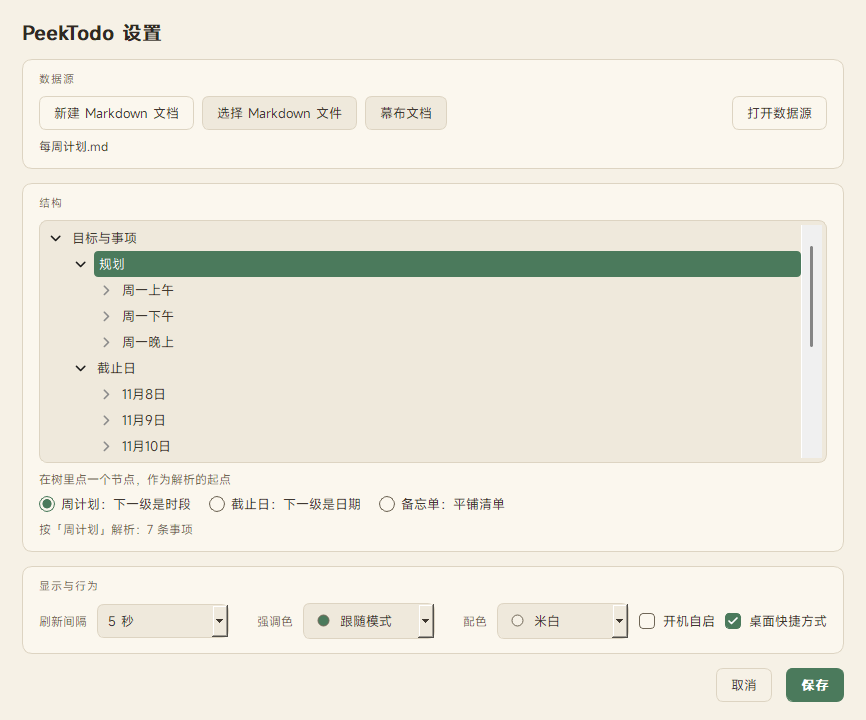
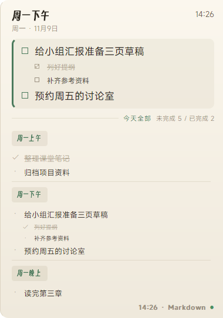
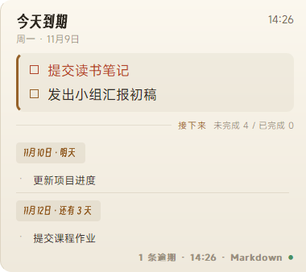
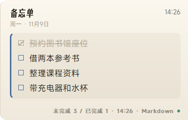

# PeekTodo

[English](README.en.md)

把周计划、截止日和备忘单贴在 Windows 主屏幕右边缘。鼠标移到边缘就能看到当前事项，移开后面板收回。支持本地 Markdown 和幕布桌面端的本地备份。

## 安装与启动

### 首次安装

准备 **Windows 10 或 11**、**Python 3.10 或更新版本**和 **Git**，然后在 PowerShell 中运行下面四行。

```powershell
git clone https://github.com/ConstVain/PeekTodo.git
cd PeekTodo
python -m pip install -e .
.\start.cmd
```

首次打开设置时，选好数据源和模式，保留勾选「桌面快捷方式」，然后点「保存」。桌面上就会出现 **PeekTodo** 图标。

### 日常启动

**双击桌面上的 PeekTodo 图标**。应用会出现在系统托盘，把鼠标移到主屏幕最右边就能看到面板。想让它在登录 Windows 时自动运行，可在设置里勾选「开机自启」。

## 设置数据源

- 如果已有 **Markdown 文件**，点「选择 Markdown 文件」，在「结构」树里选中要显示的根节点，再选模式并保存。
- 点「新建 Markdown 文档」时，默认选中 `Example-plan_simple.md`。确认模板后，保存窗口会填好类似 `261108_目标与事项.md` 的文件名。创建后自动打开编辑器，并在设置里选中该文件。用内置计划模板时，也会选好「规划」节点和「周计划」模式。保存文件后，结构树会自动刷新。新建和选文件共用上次使用的目录。
- 如果使用 **幕布**，先在幕布桌面端打开文档，让本机生成备份，再从 PeekTodo 的「幕布文档」列表里选择。

<p align="center">
  
</p>

随时可以从托盘打开「设置…」。配色可在米白和深色之间切换。强调色可以跟随模式、选择预设色，或在「自定义…」中选色并添加到列表。列表里的颜色可以用右侧的垃圾桶删除。托盘里的「立即刷新」会重新读取当前数据源。

## 使用面板

| 操作 | 结果 |
| --- | --- |
| 鼠标贴住主屏幕最右边 | 展开面板 |
| 鼠标移开 | 自动收回 |
| 点击面板 | 钉住面板 |
| 点击离面板较远的位置，或按 Esc | 解除钉住 |
| 拖动左上角或左下角 | 调整面板大小，文字跟随缩放 |
| 点击事项左侧的标记 | 勾选或取消勾选 |

### 在同一面板显示多个区块

点面板左下角的 `+`，从当前数据源选择一个节点，选好模式，再点「添加」。新区块会排在已有内容下方，内容较多时可滚动查看。

点附加区块右上角的 `−` 即可移除它。添加和移除会立即保存，源文档和勾选记录都会保留。

### 三种模式

<table>
<tr>
<th width="33%">周计划</th>
<th width="33%">截止日</th>
<th width="33%">备忘单</th>
</tr>
<tr>
<td></td>
<td></td>
<td></td>
</tr>
<tr>
<td>根节点下按时段分组，例如 <code>周一下午</code>。上方是当前时段，下方是当天全部安排。</td>
<td>根节点下按日期分组，例如 <code>11月9日</code> 或 <code>明天</code>。上方显示逾期和今天到期，下方显示接下来。</td>
<td>根节点下直接列事项。面板显示整张清单。</td>
</tr>
</table>

可在 `config.json` 的 `vocabulary` 中添加星期和时段别名。未识别的分组仍会显示，只是不会参与时间筛选。

## 数据与排查

- 面板勾选不会修改源文档。记录保存在 `%APPDATA%\PeekTodo\.state.json`，七天后过期。
- 源码版优先使用仓库里的 `config.json`。没有本地配置时，可沿用 `%APPDATA%\PeekTodo\config.json`。安装版使用用户目录里的配置。
- PeekTodo 不联网。幕布模式读取本机备份，右下角显示的时间取自备份文件。近期编辑只有在本地备份更新后才会出现在面板里。读取失败时，面板会提示并保留本次运行中最后一次成功读取的内容。

<details>
<summary>更新版本或诊断数据源</summary>

更新时先从托盘退出 PeekTodo，在原目录运行 `git pull`，再双击桌面图标启动。依赖有变化时，在原目录重新执行 `python -m pip install -e .`。如果换了源码目录，从新目录启动并保存一次设置，快捷方式就会指向新副本。

在仓库根目录执行下面的命令，可以查看启动路径或检查随附的示例模板。把 `config.example.json` 换成自己的配置文件路径，即可诊断自己的数据源。

```powershell
python -m peek_todo --where
python -m peek_todo --doctor --config config.example.json
```

</details>

## 开发

```powershell
python -m pip install -e ".[dev]"
python -m pytest -q
```

从 [架构与源码阅读路线](docs/architecture.md) 了解一次刷新和一次勾选如何走过各个模块。

## 许可证

[GPL-3.0](LICENSE)。内置字体来源见 [第三方资源说明](THIRD_PARTY_NOTICES.md)。
