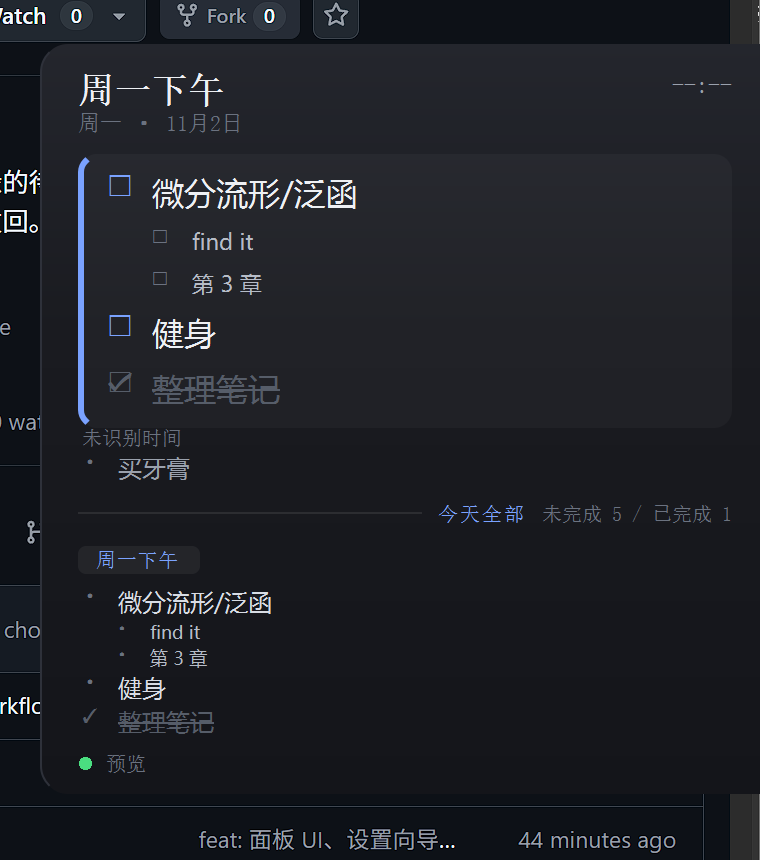
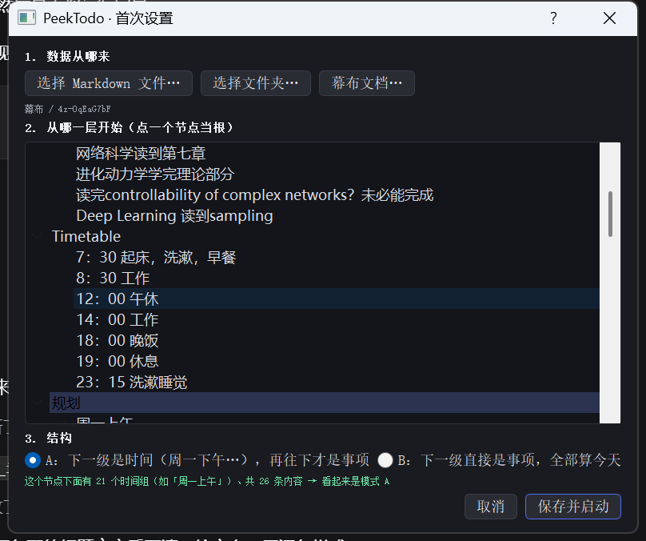

# PeekTodo

贴在屏幕右边缘的待办面板。鼠标贴到主屏最右边，滑出你今天要做的事；鼠标离开自动收回。
常驻托盘，永不抢焦点，可开机自启。

[English](README.en.md)



## 它解决什么

你有周计划，但不会为了看一眼今天该干什么去打开幕布或翻笔记。
PeekTodo 把它贴在屏幕边缘，抬一下鼠标就能看到。

**数据源**：本地 Markdown（`- [ ]` 列表）或幕布文档。
**只读**：不修改你的文件；面板上的勾选只存在本地，7 天后自动失效。

## 快速开始

```bash
git clone https://github.com/ConstVain/PeekTodo.git
cd PeekTodo
pip install .
peektodo
```

也可以不安装，直接从源码跑：

```bash
pip install -r requirements.txt
python -m peek_todo
```

首次运行会弹出设置向导：选数据源 → 在结构树里点一个节点当根 → 选模式 → 保存。



之后：

```bash
peektodo                    # 正常使用（托盘常驻）
peektodo --setup            # 重新设置
peektodo --force-shown      # 强制展开，调样式用
peektodo --doctor           # 命令行体检
```

装成包之后，配置放在 `%APPDATA%\PeekTodo\`；直接跑源码时配置就在仓库根目录（便携）。

## 三种模式

| 模式 | 根的直接子节点 | 面板怎么显示 | 适合 |
|---|---|---|---|
| **周计划** | 时段（`周一下午`） | 上方当前时段，下方今天 | 按周排课/排班的计划 |
| **截止日** | 日期（`11月2日`） | 上方逾期 + 今天到期，下方「接下来」 | DDL、作业、交付 |
| **备忘单** | 直接是事项（没有分组） | 全部常驻，不做任何筛选 | 本周计划、长期提醒 |

前两种的结构一样（根 → 分组 → 事项），区别只在于**分组标题怎么解读**：当作"一周里的某个时段"，还是当作"某个日期"。备忘单没有分组，根下面就是清单。

日期支持这些写法：`11月2日`、`11月3号`、`2026-11-02`、`11/2`、`今天`、`明天`、`后天`。
时段支持：`周一下午`、`星期二上午`、`礼拜三`、`周7 早上`，也可以在 `config.json` 的 `vocabulary` 里加别名。

选错模式不会给你空面板：周计划模式下如果标题全是日期，会提示「也许该选截止日」；结构是平铺清单时会自动降级成备忘单。

## 为什么不用固定语法

不同人的写法差别很大（「周一下午」/「礼拜一下午」/「下午」）。PeekTodo 不要求你改文档：

- 时间词靠可配置词表识别（见 `config.json` 的 `vocabulary`）
- 认不出来的标题**照样显示**，只是不参与时段筛选，并在底部标出来
- `--doctor` 把"程序看懂了什么"直接打出来，认错了一眼能看见

```
来源   docs/sample-plan.md
根     周计划
模式   周计划
──────────────────────────────────────────────
✓ 周一下午                  周一下午  ·  4 条（2 层）
✓ 周二上午                  周二上午  ·  2 条
! 待定                      未识别时间  ·  1 条
──────────────────────────────────────────────
事项 8 条，其中已完成 1 条
```

## 目录

```
peek_todo/
├─ model.py         Node / Task / Group
├─ vocabulary.py    时段与日期识别（词表可配）
├─ structure.py     根节点 + 三种模式
├─ selection.py     按当前时间切片
├─ state.py         本地勾选（不碰源文件）
├─ edge.py          贴边判定
├─ report.py        识别报告
├─ doctor.py        命令行体检
├─ autostart.py     开机自启（HKCU Run）
├─ app.py           入口：窗口、托盘、轮询
├─ assets/          托盘图标与应用图标
├─ sources/
│  ├─ markdown.py   标题 + 列表项
│  └─ mubu.py       幕布本地备份
└─ ui/
   ├─ panel.py      面板
   └─ wizard.py     首次设置向导
```

## 开发

```bash
python -m pytest tests -q
verify.cmd            # 测试 + 两个数据源的体检
```

## 说明与限制

- **只读**：不写入 Markdown 或幕布文档。面板上的勾选是本地的，不改变源。
- **不联网**：没有任何网络请求。
- **幕布源**读取桌面端本地缓存，属于非公开格式，客户端升级可能失效；失效时保留上次数据并提示。
- 仅支持 Windows 10/11（依赖 Win32 的 `WS_EX_NOACTIVATE` 与光标轮询）。

## 许可证

GPL-3.0，见 [LICENSE](LICENSE)。因为依赖 PyQt5（GPL/商业双许可），整个项目按 GPL 发布。
